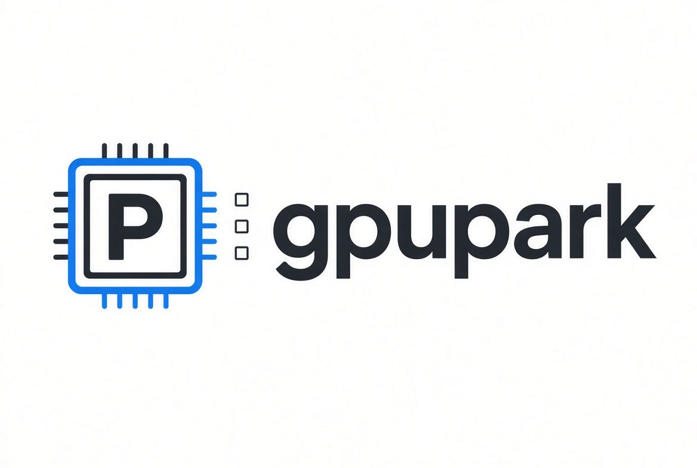

<p align="center">
  
</p>

# gpupark

**One GPU. Many tenants. Lease it, and park what's idle.**

`gpupark` is a single-node GPU lease broker. A resident model (or any service) is
registered as the *baseline*: it holds the card while nothing else needs it, and
gives it up the moment a job asks. When the queue drains, the baseline comes back.

It exists because "run ComfyUI next to a 21 GB local LLM on one 24 GB card" has no
good answer: llama-swap only swaps LLM backends, Slurm/Kueue are cluster schedulers,
and `flock` scripts cannot stop and restart a resident service.

```
$ gpupark run --need 22 -- comfy run workflow.json
queued 3f2a (need 22.0 GB, prio 0) ... granted
parking baseline tensorfold (systemd unit) ... parked
gpu free 23.1 GB / 24.0 GB ... starting comfy
... job output ...
job exited 0; restoring baseline tensorfold in 5s
```

## Install

**One line, Linux and macOS** — installs into `~/.local/share/gpupark`, links
`~/.local/bin/gpupark`, no sudo, nothing added to your system Python:

```sh
curl -fsSL https://raw.githubusercontent.com/zweck/gpupark/main/install.sh | sh
```

Then:

```sh
gpupark config init         # write ~/.config/gpupark/workloads.yaml
gpupark doctor              # check nvidia-smi, systemd, the daemon
gpupark install-service     # Linux: run the broker as a systemd --user unit
```

Uninstall with `curl -fsSL .../install.sh | sh -s -- --uninstall`. If you already
have pipx or uv, `pipx install gpupark` / `uv tool install gpupark` work too.

macOS: there is no `nvidia-smi`, so set `gpu_probe: none` in the config — the
queue still serialises jobs, it just cannot check VRAM. `gpupark daemon` runs in
the foreground (systemd is Linux-only).

## Commands

```bash
gpupark run --need 22 --ttl 1800 -- ./render.sh     # queue a command
gpupark lease comfyui --for 3600                    # hold a registered unit
gpupark pause [ID]                                  # give the card back, keep your place
gpupark resume [ID]                                 # take it again
gpupark status | cancel <id> | workloads | doctor
```

## Pausing

`gpupark pause` hands the card back without giving up the lease; `gpupark resume`
takes it again. Both act on the current lease by default and take a job id
otherwise (`gpupark pause 3f2a`).

- **A running unit lease** — the workload is stopped and the baseline restarted,
  so the resident model answers again while the lease stays yours. `resume` parks
  the baseline, waits for the VRAM to actually free, then starts the workload.
- **A queued job** — `gpupark pause <id>` holds it out of the queue: it is not
  granted until you resume it, and it keeps its priority and place in line. This
  is how you keep a submission for later without parking the card behind it.
- **A running command job** — the process group is SIGSTOPped. Suspending does
  **not** free VRAM (a stopped CUDA process keeps its allocations), so the
  baseline cannot come back: use it to give up the CPU, not the card. Pause the
  job while it is still queued if the GPU is what you want back.

Paused time does not count against `--ttl`: the deadline moves out by however
long the job was paused. `gpupark status` lists paused jobs under the queue with
the `resume` hint.

## Workloads

`~/.config/gpupark/workloads.yaml`:

```yaml
gpu: 0
cooldown_seconds: 5

workloads:
  tensorfold:
    kind: unit
    target: tensorfold-qwen27.service   # systemd --user unit
    vram_gb: 21
    baseline: true                      # runs whenever the queue is empty
    priority: -10
  comfyui:
    kind: unit
    target: comfyui.service
    vram_gb: 22
  game:
    kind: command
    target: ["./run-headless.sh"]
    vram_gb: 8
```

A workload is either a `unit` (systemd --user) or a `command` (argv). Exactly one
workload may set `baseline: true`; it is started at daemon boot and after every lease.

## CLI

| command | meaning |
|---|---|
| `gpupark run --need 22 -- CMD...` | queue an ad-hoc command, wait for the lease, run it |
| `gpupark lease comfyui --for 1800` | start a registered unit and hold the card for N seconds |
| `gpupark status` | lease, queue, VRAM, baseline state |
| `gpupark cancel ID` | drop a queued job or stop a running one |
| `gpupark pause [ID]` | hand the card back; keep the lease and the queue place |
| `gpupark resume [ID]` | re-grant a paused lease, or requeue a paused job |
| `gpupark doctor` | check nvidia-smi, systemd, units, config |
| `gpupark daemon` | run the broker in the foreground (what the unit runs) |

## Semantics

- **Exclusive by default.** One lease at a time; the broker verifies with `nvidia-smi`
  that the requested VRAM is actually free before granting (stopping a service is not
  the same as its memory being returned).
- **Priority then FIFO.** Higher `priority` first, ties in submission order.
- **The baseline is the only workload that may be preempted.** A running job is never
  evicted by a later arrival.
- **The TTL is running time, not wall time.** A job past its `--ttl` is stopped the same
  way `cancel` stops it (a unit is stopped, a command is terminated), and time spent
  paused is subtracted before that deadline is checked.
- **A dead client does not leak a lease.** The broker owns the process/unit; the lease
  ends when the job exits, its TTL expires, or `gpupark cancel` stops it.
- **Crash recovery.** The queue is journaled to `$XDG_RUNTIME_DIR/gpupark/state.json`;
  on restart, stale leases are dropped and the baseline is restored.

## Status

Milestone 1 (this release): daemon, queue, baseline preemption/restore, pause/resume,
CLI, systemd integration, tests with a fake GPU. Milestone 2: ComfyUI adapter (hold the
lease until the prompt finishes), multi-GPU pools, `gpupark top`. Milestone 3:
webhooks/metrics.

Apache-2.0.
